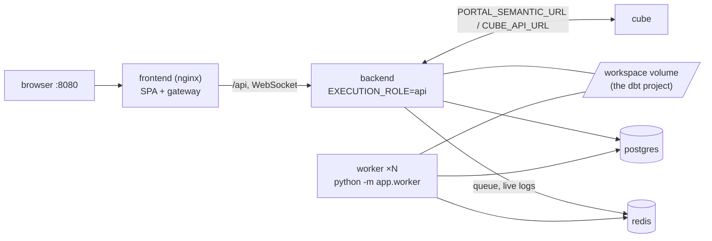

# Running the portal with Docker or Podman Compose

How to run the whole portal from this repo, on one machine, with **Docker Compose or Podman
Compose** (the same files for both). For Kubernetes see [KUBERNETES.md](KUBERNETES.md); for
every setting and the client-kit installer see [ONBOARDING.md](ONBOARDING.md).

> **Status of what is tested.** The Compose files and scripts here are validated by
> `scripts/validate.sh` (rendering, assertions, ShellCheck) with Docker Compose 5.x. They have not
> been started in a container engine as part of this work, and Podman Compose has not been run at
> all: record the Docker Compose and Podman versions you support in
> [Compatibility record](#compatibility-record) once you have run them.

## Files

| File | What it is |
|---|---|
| [compose.yaml](../compose.yaml) | **Full stack**: frontend, backend (API), worker, Cube, PostgreSQL, Redis. For anything shared. |
| [compose.single.yaml](../compose.single.yaml) | **Single node**: backend (API + dbt), Cube, frontend. SQLite, no Redis, no worker. Laptop, demo, trial. |
| [compose.build.yaml](../compose.build.yaml) | Overlay on the full stack: build the three images from the sibling repos. |
| [compose.single.build.yaml](../compose.single.build.yaml) | The same overlay for the single-node stack. |
| [compose.cube-sql.yaml](../compose.cube-sql.yaml) | Overlay that publishes Cube's SQL API (BI tools) on either stack. |
| [.env.example](../.env.example) | Every setting with its default; copied to `.env` (ignored by git). |
| `compose.override.yaml` | Written by `scripts/portal.sh` only when this machine needs one (see [local override](#the-generated-local-override)). Ignored by git. |
| [scripts/portal.sh](../scripts/portal.sh) | One command for all of it: `init`, `check`, `up`, `down`, `logs`, Helm... |
| [scripts/release-tags.sh](../scripts/release-tags.sh) | Prints the image tags of a release from [releases.yml](../releases.yml). |
| [scripts/validate.sh](../scripts/validate.sh) | The checks CI runs, runnable locally. |
| [scripts/build-kit.sh](../scripts/build-kit.sh) | Assembles the client kit a client downloads (compose files, `setup.sh`/`manage.sh`/`portal.sh`, the Helm chart, the release's tags). Local, server, systemd service and Kubernetes installs: [deploy/client/README.md](../deploy/client/README.md#where-to-run-it-this-computer-a-server-a-service-kubernetes). |

## Prerequisites

* **Docker** (Engine with the Compose plugin v2, or Docker Desktop) **or Podman** 4+ with a
  compose provider (`podman-compose`, or Docker's `docker-compose` on `PATH`).
* `bash` 3.2+ (macOS, Linux, WSL, Git Bash), `openssl` (or `/dev/urandom` and `base64`), `curl`.
  Windows without bash: use the PowerShell client kit (`deploy/client/setup.ps1`).
* About 6 GB RAM and 10 GB disk for the full stack.
* For **published images**: access to `ghcr.io/omaryehia015` (`docker login ghcr.io` with a token that
  has `read:packages`). For **source builds**: the sibling repos, below.

## Quick start

```bash
git clone <this repo> && cd capgemini-dbt-portal-deploy

scripts/portal.sh init        # creates .env from .env.example, generates the empty secrets
$EDITOR .env                  # the dbt project: DBT_PROJECT_PATH, or a git URL (see below)
scripts/portal.sh check       # tools, settings, project, tags, Compose rendering
scripts/portal.sh up          # full stack, from the published images
# -> http://localhost:8080
```

`init` never overwrites a value that is set, never prints a secret (it lists the *names* it
generated), and sets permission `600` on `.env` where the file system has permissions. Run it
as often as you like. The first sign-in passwords are printed once in the backend log:

```bash
scripts/portal.sh logs backend --no-follow | grep -A6 "GENERATED INITIAL CREDENTIALS"
```

The script works from any directory (`/path/to/scripts/portal.sh up`) and returns non-zero on
any failure.

### Commands

| Command | Does |
|---|---|
| `init` | `.env` from `.env.example`, generated secrets, the local override if needed. `--release NAME` also pins that release's image tags. |
| `check` | Validates tools, required variables, the project source, image tags, source repos (with `--build`) and the Compose rendering. `--helm` adds the Helm prerequisites. Changes nothing. |
| `build [svc]` | Builds the images from the sibling repos. |
| `pull [svc]` | Pulls the published images. |
| `up` | Starts the stack in the background and waits until the portal answers. |
| `down` | Stops it and removes the containers. **Data is kept.** |
| `restart [svc]` | Restarts everything, or one service. |
| `status` | `compose ps` and the portal's `/api/version`. |
| `logs [svc]` | Follows the logs; `--no-follow` prints the recent lines. |
| `clean` | Removes containers, networks and locally built images. **Data is kept.** |
| `release` | Prints the three tags of a release (`--release NAME`, default latest). |
| `helm-*` | See [KUBERNETES.md](KUBERNETES.md). |

Options: `--single`, `--build`, `--cube-sql`, `--engine docker|podman`, `--env-file FILE`,
`--release NAME`, `--volumes`, `--yes`. `scripts/portal.sh --help` lists them all.

**Deleting data needs `--volumes`** (on `down` or `clean`), which lists the volumes and asks you
to type `delete data` (or pass `--yes`). The host backup folder (`PORTAL_BACKUP_DIR`), a mounted
dbt project and `.env` are never touched.

## Docker or Podman

`portal.sh` uses the first provider that works, in this order:

1. `docker compose` (Docker Engine/Desktop answering)
2. `podman compose`

Choose one explicitly with `--engine docker|podman` or `PORTAL_ENGINE=podman`. When none works,
the error says why for each (not installed, no compose plugin, engine not running).

The same Compose files serve both; there is no separate Podman file. By hand:

```bash
docker compose -f compose.yaml up -d          # or: podman compose -f compose.yaml up -d
docker compose -f compose.single.yaml up -d
docker compose -f compose.yaml -f compose.build.yaml up --build -d
```

Podman specifics already handled in the files: health checks are declared in Compose (Podman's
default OCI images drop the Dockerfile `HEALTHCHECK`); Podman does not create a missing host
folder, so `init` creates `PORTAL_BACKUP_DIR`; on macOS and under Podman, bind mounts need
`PORTAL_USER=0:0` (init sets it for a local project). Podman's Windows client mangles absolute
`/mnt/c/...` paths: use a relative `DBT_PROJECT_PATH` there. `podman compose` needs a provider:
`pip install --user podman-compose`, or the `docker-compose` binary.

## The two modes



| | Full stack (`compose.yaml`) | Single node (`compose.single.yaml`) |
|---|---|---|
| Containers | frontend, backend, worker, cube, postgres, redis (+ the one-off `upgrade`) | frontend, backend, cube (+ the one-off `backup-folder`) |
| Database / queue | PostgreSQL / Redis | SQLite on `portal_data` / none |
| dbt runs | on the worker(s); scale with `--scale worker=3`, `WORKER_CONCURRENCY` | inside the backend process |
| Host ports | frontend `PORTAL_PORT` (8080); Cube SQL on 127.0.0.1 | frontend on `127.0.0.1:8080` only |
| Use | shared, team, server | laptop, demo, trial: **not** for shared use |

Both modes: backend `:8000`, Cube `:4000` and (full) PostgreSQL/Redis are on the internal
network only. The frontend proxies `/api` (the job-log WebSocket included) to `backend:8000`.

Volumes: `postgres_data`, `redis_data` (used only with `REDIS_APPENDONLY=yes`), `portal_data`
(the dbt editor's trash, Cube's state, the credentials key), `workspace` (the dbt project when it
is not a host folder), `backups` (when `PORTAL_BACKUP_DIR` is unset), `projects` (the optional
shared host folder), and the read-only legacy `execution_data`/`semantic_data` that `upgrade`
moves into the new layout once.

## Images: published or built from source

**Published** (default): `ghcr.io/omaryehia015/capgemini-dbt-portal-{backend,frontend,cube}`,
each with its own tag (`BACKEND_TAG`, `FRONTEND_TAG`, `CUBE_TAG` in `.env`). The backend image
runs the API *and* the worker; they share one tag. Tags are `dev-<sha>`, `test-<sha>`,
`prod-<sha>` (an environment's pipeline build) or a release version such as `1.0.1`.

**Release selection.** [releases.yml](../releases.yml) is the tested compatibility map: which
backend, frontend and Cube tags passed the end-to-end test together.

```bash
scripts/release-tags.sh --list                  # releases, newest first, latest marked
scripts/release-tags.sh                         # the latest, as KEY=VALUE
scripts/release-tags.sh 2026.10.17              # a named release
scripts/portal.sh init --release latest         # writes the three tags into .env
scripts/release-tags.sh --write-env .env        # the same, without init
```

It fails if the release does not exist or a tag is missing, and never changes `releases.yml`.
`.env.example` always carries the latest release's tags (CI enforces it); the client kit
(`setup.sh --release`) uses the same file.

To see what each environment last published (not a tested combination), read `images/dev.yaml`,
`images/test.yaml` and `images/prod.yaml`: the component pipelines record their newest image there
through a pull request (`record-image.yml`, see the developer guide). Put its `tag` values in
`BACKEND_TAG`, `FRONTEND_TAG` and `CUBE_TAG` to run exactly that build.

**Source build.** Check the three repos out next to this one:

```
work/
  capgemini-dbt-portal-backend/
  capgemini-dbt-portal-frontend/
  capgemini-dbt-portal-cube/
  capgemini-dbt-portal-deploy/      <- run from here
```

```bash
scripts/portal.sh --build up            # builds, then starts (full stack)
scripts/portal.sh --single --build up   # single node
scripts/portal.sh build backend         # just one image
```

Contexts and build arguments are the ones each `Dockerfile` declares: `APP_VERSION` for all
three (shown in the UI footer and `/api/version`; `PORTAL_BUILD_VERSION`, default `local`) and
`EXTRA_PIP_PACKAGES` for the backend (a non-Snowflake warehouse). The **backend image is built
once** and used by both the API and the worker. Repos elsewhere: `BACKEND_SRC`, `FRONTEND_SRC`,
`CUBE_SRC` in `.env`. Built images are tagged `capgemini-dbt-portal-<name>:source`.

## Where the dbt project comes from

`PROJECT_SOURCE` in `.env` (read by `portal.sh`) picks one of three. Unset, it is `git` when
`DBT_PROJECT_GIT_URL` is set, else `local` when `DBT_PROJECT_PATH` is set, else `volume`.

| `PROJECT_SOURCE` | What happens | Set |
|---|---|---|
| `local` (default for local development) | A host folder is mounted read-write at `/workspace` in the backend **and** the worker. The dbt editor writes into it. | `DBT_PROJECT_PATH=../capgemini_dbt_core` (relative to the compose file, or absolute) |
| `git` | The backend clones the repo into the `workspace` volume at start and fast-forwards it on every restart; the worker only mounts that volume. | `DBT_PROJECT_GIT_URL`, `DBT_PROJECT_GIT_REF`, `DBT_PROJECT_GIT_TOKEN`, `DBT_PROJECT_GIT_USERNAME`, `DBT_PROJECT_SUBDIR`; leave `DBT_PROJECT_PATH` empty |
| `volume` | A Compose named volume is the workspace, filled in the Setup Assistant or earlier. Backend and worker mount the same one. | nothing, or `DBT_WORKSPACE_VOLUME=<existing volume>` to use one you already have |

`check` refuses contradictions (a git URL with `PROJECT_SOURCE=local`, an empty path for
`local`, a URL that embeds credentials) and never prints the URL or token. Credentials are never
written to the backend's git config: the entrypoint hands the token to git through a credential
helper. A **path with spaces** is fine: `portal.sh` then mounts it with Compose's long syntax in
the generated override. A private HTTPS repo needs `DBT_PROJECT_GIT_TOKEN` (`DBT_PROJECT_GIT_USERNAME`
is `x-access-token` for GitHub, `oauth2` for GitLab).

### The generated local override

`scripts/portal.sh init|up` writes `compose.override.yaml` (git-ignored, marked "Generated by
scripts/portal.sh") **only** when this machine needs one: a project path the short volume syntax
cannot carry (spaces, or any path under a Windows shell), an existing named volume as the
workspace (`DBT_WORKSPACE_VOLUME`, declared external), or your `~/.dbt/profiles.yml` when the
project has none of its own (mounted read-only at `/profiles`). It rewrites or removes its own file
on the next run and **never touches a `compose.override.yaml` it did not write** (people keep an
external `DATABASE_URL` there): if it needs one and finds yours, it stops and says what to add.
`deploy/client/setup.sh` writes the same file for the client kit; the two do not run together.

## Configuration and secrets

* **`.env`** holds everything: it is read by Compose for the `${...}` values and passed, whole, to
  the **backend and worker** only (`env_file`). The frontend gets only its non-secret gateway
  settings (backend address, the optional Airflow proxy); Cube gets `CUBEJS_API_SECRET` and the
  backend URL. No secret reaches the frontend.
* **`.env.example`** is names, defaults and empty placeholders. Never put a real value in it.
* **Required secrets** (`init` generates each empty one, 48 letters and digits so they fit in
  URLs): `JWT_SECRET` (session tokens; changing it signs everyone out), `CUBE_API_SECRET` (shared by
  backend and Cube), `POSTGRES_PASSWORD`, `REDIS_PASSWORD` (full stack). In the single-node
  stack only `CUBE_API_SECRET` is required.
* **`PORTAL_SECRET_KEY`** (optional here): the key stored warehouse logins are encrypted with. Unset,
  the backend makes one on the `portal_data` volume, which backend and worker share. Setting a **new**
  value on a portal that already holds stored logins makes them unreadable.
* `DATABASE_URL` and `REDIS_URL` are built in `compose.yaml` from the two passwords. An external
  PostgreSQL: put `DATABASE_URL` for backend and worker in your own `compose.override.yaml`.
* **Git credentials, warehouse credentials, AI keys, SMTP/LDAP passwords**: optional; see
  [.env.example](../.env.example). Warehouse logins are best entered in the portal or kept in the
  project's own `.env`; they are not needed here.
* **Another env file**: `scripts/portal.sh --env-file /path/to/prod.env up`. It sets
  `PORTAL_ENV_FILE` so the containers read the same file. By hand, give both: `docker compose
  --env-file X ...` with `PORTAL_ENV_FILE=X` exported.
* The script reads env files line by line; it never `source`s them, so a value cannot run code.

## What is exposed on the host

| Port | Published? |
|---|---|
| frontend `8080` | Yes: `${PORTAL_BIND:-0.0.0.0}:${PORTAL_PORT:-8080}` (full stack). Single node: `127.0.0.1` only. Behind a TLS reverse proxy on the same host, set `PORTAL_BIND=127.0.0.1`. |
| frontend `8082` (Airflow UI proxy) | Only with `AIRFLOW_UI_PORT`. Unset, Compose still maps the container port to an unused random host port (nothing listens on it): on every interface in the full stack, on `127.0.0.1` in the single-node stack. |
| Cube SQL `15432` | **Full stack: `127.0.0.1` only** (`CUBE_SQL_BIND`). Single node: not at all, unless `--cube-sql`. |
| backend `8000`, Cube `4000`, PostgreSQL, Redis, worker | Never |

> **Upgrade note (Cube SQL).** Earlier versions of `compose.yaml` published Cube's SQL port on every
> interface. It is now on `127.0.0.1`. BI tools on **other** machines need `CUBE_SQL_BIND=0.0.0.0` in
> `.env`, and the port should then be restricted by the host firewall or a VPN: it is the Postgres
> protocol without TLS (logins are per user and checked by the backend, but the channel is plain).

## Security defaults

Applied to the four application containers, because the images support them: `no-new-privileges`,
all Linux capabilities dropped, non-root users (backend and worker `10001:10001`, nginx `101`, Cube
`node`), no secret in the frontend, internal-only data services. The backend and worker keep three
capabilities (`CHOWN`, `DAC_OVERRIDE`, `FOWNER`) that matter only with `PORTAL_USER=0:0`, which Docker/Podman
Desktop bind mounts need; the default non-root user has no capabilities either way.

Deliberately **not** set: a read-only root filesystem. The backend entrypoint writes to the user's
home (`git config`), `/tmp` and the workspace; the nginx image renders its configuration into
`/etc/nginx/conf.d` at start. A read-only root would stop both. PostgreSQL and Redis get
`no-new-privileges` only: their entrypoints start as root to prepare the data directory.

## Day to day

```bash
scripts/portal.sh status
scripts/portal.sh logs backend            # Ctrl-C to stop following
scripts/portal.sh restart worker
scripts/portal.sh down                    # keeps all data
scripts/portal.sh --volumes down          # DELETES the volumes (asks first)
scripts/portal.sh clean                   # containers, networks, built images; keeps data
```

**Backups and restore.** The portal writes its own backup (database rows, `/data`, the project when
it lives on the portal's volume) every `BACKUP_INTERVAL_HOURS` into `PORTAL_BACKUP_DIR`, a host folder
`down -v` does not touch. `deploy/client/manage.sh backup | backups | restore` (kit installs) wraps
it. It does not contain `PORTAL_SECRET_KEY` when you set that yourself: keep it in your secret store.
For PostgreSQL itself, also use the server's own backups (`pg_dump`, snapshots).

**Upgrade.** Pick a release, pull, start. Data and `.env` survive:

```bash
scripts/release-tags.sh --list
scripts/portal.sh init --release 2026.10.19      # rewrites only the three *_TAG lines
scripts/portal.sh pull && scripts/portal.sh up
```

The one-off `upgrade` service runs on every start of the full stack: it moves a pre-2026.11
multi-database portal into one database and volume (`postgres/upgrade.sh`), and otherwise only
makes `/data` and `/backups` writable for the backend's user.

**Scale workers.** `docker compose up -d --scale worker=3` (workers share the workspace, so on one
host, or a ReadWriteMany volume).

## Troubleshooting

| Symptom | Likely cause and fix |
|---|---|
| `no usable Compose provider` | Docker/Podman not installed, no compose plugin, or the engine is not running (Docker Desktop, `podman machine start`). The message lists each. |
| `JWT_SECRET is empty or a placeholder` | Run `scripts/portal.sh init`. |
| `DBT_PROJECT_PATH is not a directory` | The default points at `../capgemini_dbt_core`. Set your path, or use git/volume. |
| `compose.override.yaml exists and was not written by scripts/portal.sh` | You have your own; merge the settings the message names into it, or move it aside. |
| `dbt deps` fails with "Operation not permitted" on a mounted project | Desktop bind mounts: `PORTAL_USER=0:0` in `.env`. |
| A bind-mounted project is read-only to the portal | Check the folder's permissions; with `PORTAL_USER=10001:10001` the folder must be writable by uid 10001. |
| `pull access denied` | `docker login ghcr.io` with a token that has `read:packages`. |
| Port 8080 is taken | `PORTAL_PORT=8081` in `.env`. |
| Backend not healthy for minutes at first start | Normal: it clones the project and runs migrations; `scripts/portal.sh logs backend`. |
| A BI tool cannot reach Cube SQL | It is on `127.0.0.1`: see the upgrade note above. |
| Source build cannot find a Dockerfile | `check --build` names the missing directory; set `BACKEND_SRC` etc. |

## Compatibility record

Fill this in when you have run the stack; nothing below is claimed until then.

| Component | Supported version | Tested how |
|---|---|---|
| Docker Engine / Desktop | _to record_ | |
| Docker Compose | _to record_ (files rendered with 5.4.0 only) | `scripts/validate.sh compose` |
| Podman | _to record_ (not run) | |
| Podman compose provider | _to record_ (not run) | |
