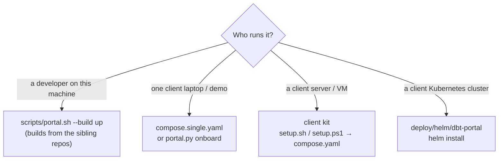
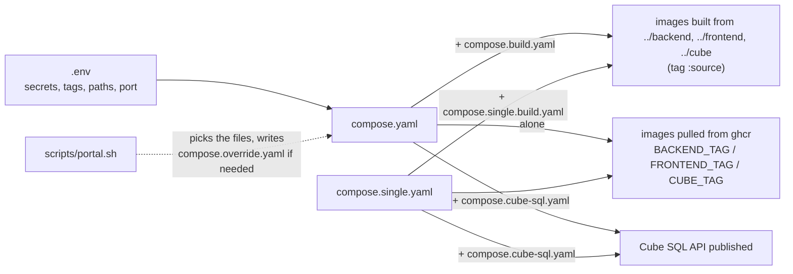
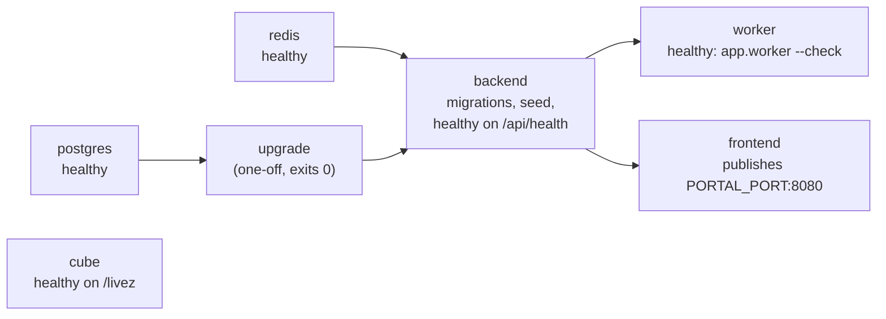
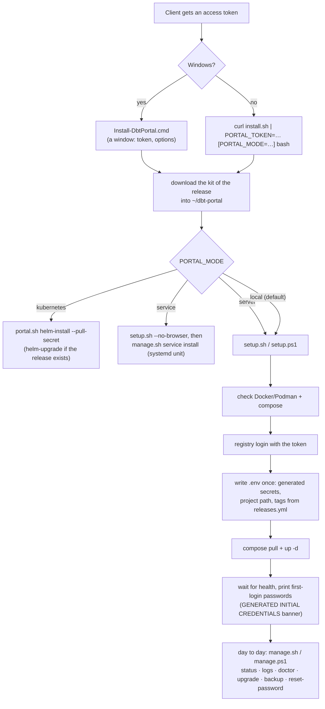
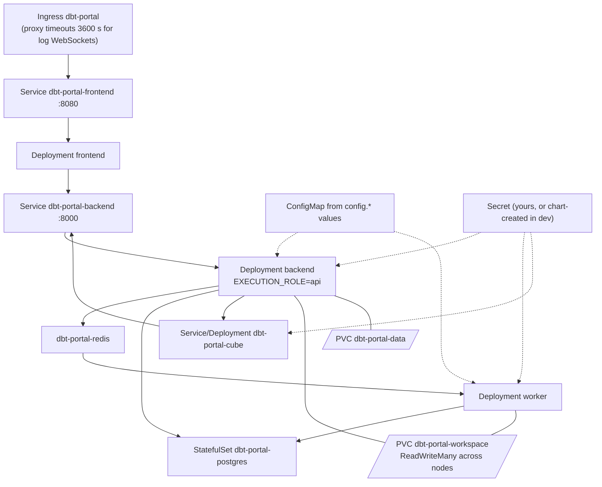
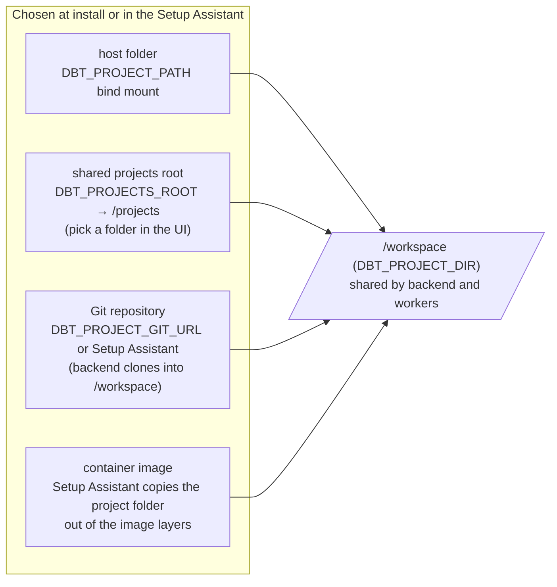
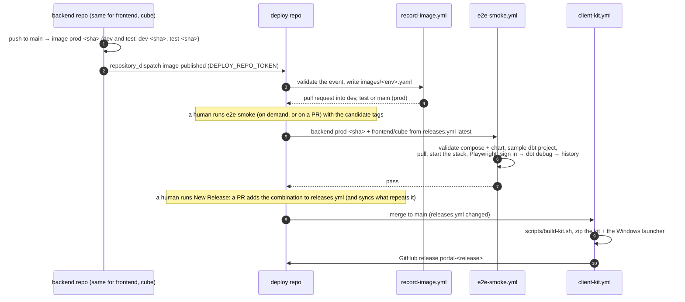

# Deploy repo developer guide

This repo holds no application code. It decides **how the images run
together** (compose, Kubernetes, VM, client kit) and **which versions go
together** (`releases.yml`). Read [SYSTEM_GUIDE.md](SYSTEM_GUIDE.md) first for
the whole picture and [ARCHITECTURE.md](ARCHITECTURE.md) for the containers.
Operators installing for a client read [ONBOARDING.md](ONBOARDING.md).

- [1. Folder map](#1-folder-map)
- [2. Deployment shapes](#2-deployment-shapes)
- [3. How the compose files combine](#3-how-the-compose-files-combine)
- [4. The client kit](#4-the-client-kit)
- [5. Kubernetes](#5-kubernetes)
- [6. How the dbt project reaches the containers](#6-how-the-dbt-project-reaches-the-containers)
- [7. Releases and CI](#7-releases-and-ci)
- [8. Recipes](#8-recipes)

---

## 1. Folder map

```
compose.yaml            full stack: frontend, backend (api), worker, cube, postgres, redis, upgrade
compose.single.yaml     one node: backend runs dbt itself on SQLite, + cube + frontend
compose.build.yaml      overlay: build images from ../backend, ../frontend, ../cube (full stack)
compose.single.build.yaml  the same overlay for the single-node stack
compose.cube-sql.yaml   overlay: publish Cube's SQL API (either stack)
releases.yml            portal releases: backend + frontend + cube versions tested together
postgres/upgrade.sh     one-off migration from the pre-2026.11 multi-database layout
scripts/
  portal.sh             init/check/up/down/logs/clean + helm-*: Docker or Podman Compose, and Helm
  release-tags.sh       a release of releases.yml as image tags (env, Helm values, --set)
  validate.sh           the checks CI runs (parse, ShellCheck, Compose and Helm render + assertions)
  build-kit.sh          assembles the client kit of a release (compose files, scripts, the chart, its tags)
  add-release.sh        adds a release to releases.yml, makes it latest, runs sync-release.sh
  sync-release.sh       brings .env.example's tags and the chart's appVersion into line with a release
  check_manifests.py    the assertions validate.sh makes on rendered Compose and Helm output
  record_image.py       validates and writes an image record (images/<env>.yaml); used by record-image.yml
deploy/
  client/               the client kit: setup/manage/install (.sh and .ps1), lib, .env.example,
                        portal.answers.example, the download page and the Windows launcher (download/)
  helm/dbt-portal/      the Helm chart: values (dev/test/prod), schema, templates, ci/ value sets
images/                 the newest image of each component per environment (dev, test, prod), written by record-image.yml
e2e/                    Playwright smoke test of a whole stack
docs/                   ARCHITECTURE, ONBOARDING, SYSTEM_GUIDE, this guide, diagrams (.drawio/.png)
.github/workflows/      pre-check, e2e-smoke, client-kit
```

## 2. Deployment shapes



| Shape | Containers | Database | Queue | Scales |
|---|---|---|---|---|
| single node | backend (runs dbt), cube, frontend | SQLite on `portal_data` | none | no |
| full stack (compose / client kit) | frontend, backend, worker ×N, cube, postgres, redis | PostgreSQL | Redis | workers (`--workers`, `WORKER_CONCURRENCY`) |
| Kubernetes | same as full stack, as Deployments | PostgreSQL (in-cluster or managed) | Redis (same) | workers, cube, frontend replicas |

## 3. How the compose files combine



Pulling is the default everywhere; building is the explicit `--build` / `compose.*build.yaml` case.
The two stacks and their overlays are chosen by `scripts/portal.sh` (`--single`, `--build`, `--cube-sql`).

Startup order in `compose.yaml`:



Things that look odd but are deliberate:

- `user: ${PORTAL_USER:-10001:10001}`: non-root. Windows/macOS bind mounts
  need `PORTAL_USER=0:0` because they refuse `chmod` from other users and
  `dbt deps` fails.
- The backend's healthcheck is declared in compose, not only in the
  Dockerfile: Podman builds OCI images, which drop `HEALTHCHECK`.
- Redis runs with a password, no persistence: job requests briefly carry a
  one-off provisioning login, and nothing in Redis must survive a restart.
- The worker gets `DBT_PROJECT_GIT_URL: ""`: only the backend clones the
  project in git mode; the worker just mounts it.
- The four application containers share the `x-hardened` anchor
  (`no-new-privileges`, `cap_drop: ALL`); backend and worker add back `CHOWN`,
  `DAC_OVERRIDE`, `FOWNER`, which only matter with `PORTAL_USER=0:0`. There is no
  read-only root filesystem: the entrypoints and nginx write at start.
- Host ports: the frontend (`PORTAL_BIND`, `PORTAL_PORT`) and, on the full stack,
  Cube's SQL port on `127.0.0.1` (`CUBE_SQL_BIND`). The single-node stack publishes
  only the frontend, on `127.0.0.1`.
- `compose.build.yaml` leaves the worker without a `build:`: the backend image is
  built once and the worker reuses it (`pull_policy: never`). The single-node stack
  has no worker, so it has its own overlay.

## 4. The client kit

What a client receives: a zip per release (built by `client-kit.yml` with
`scripts/build-kit.sh`) and the Windows launcher. No source, no build overlay:
the images are always pulled. The kit holds the compose files, the setup and
manage scripts, `portal.sh` and `release-tags.sh`, and the Helm chart of the
release (`deploy/helm/dbt-portal`, without the CI value sets).



- `.env` is written **once**; re-running setup keeps it, so accounts and
  history survive upgrades.
- `portal.answers` (see `portal.answers.example`) makes setup zero-touch:
  `PROJECT`, `PORT`, `RELEASE`, `WORKERS`, and any other key goes into `.env`.
  The worker count is kept in `.env` as `PORTAL_WORKERS`, so upgrades, `manage.sh start`
  and the systemd service start the same number again.
- `manage.sh service install|uninstall|status|print` writes one `oneshot` systemd unit
  that runs `manage.sh start` / `stop`; it pins the engine (`PORTAL_ENGINE`, honoured by
  `lib.sh`'s `find_runtime`). Docker needs a system unit (root); `--user` is for rootless Podman.
- `portal.sh helm-install --pull-secret` makes the `ghcr-pull` Secret from `PORTAL_TOKEN`
  (sent to `kubectl` on stdin, never in an argument) and uses it for the chart.
- `scripts/validate.sh kit` builds a kit and checks all of this (contents, no build overlay,
  the unit text, the pull-secret flow, the install modes).
- `lib.sh` / `lib.ps1` hold what both scripts share. Shell scripts must pass
  `shellcheck` (CI runs it) and work on macOS, Linux and WSL; PowerShell
  scripts must work in Windows PowerShell and Podman.

## 5. Kubernetes



- The chart ([deploy/helm/dbt-portal](../deploy/helm/dbt-portal), guide:
  [KUBERNETES.md](KUBERNETES.md)) is installed as release and namespace
  `dbt-portal`. Image tags are required values, taken from one `releases.yml`
  entry (`scripts/release-tags.sh`); the chart has no default tag.
- `values-dev.yaml` turns on the bundled PostgreSQL and Redis and a chart-created
  Secret. In production (`values-prod.yaml`) point `DATABASE_URL` / `REDIS_URL`
  at managed services, in a Secret you manage (`secrets.existingSecret`).
- First-login passwords: `kubectl -n dbt-portal logs deploy/dbt-portal-backend`.
- The Kustomize manifests the chart replaced, and how to move an install across,
  are described in [KUBERNETES.md](KUBERNETES.md#migrating-from-kustomize-to-helm).

## 6. How the dbt project reaches the containers



## 7. Releases and CI



| Workflow | Runs on | Does |
|---|---|---|
| `pre-check.yml` | PRs into `dev`/`test`/`main` | promotion path (working branch → dev → test → main), gitleaks, shellcheck |
| `validate.yml` | PRs and pushes to `dev`/`test`/`main` | `scripts/validate.sh`: YAML, ShellCheck, Compose (full, single, source-build) and Helm (lint, dev/test/prod and CI value sets, assertions, kubeconform) rendered and checked, `releases.yml` consistency, no secret files, no leftover Kustomize references. Renders only: it deploys nothing. |
| `e2e-smoke.yml` | pull requests, on demand with any tags (it also answers a `component-released` dispatch; no pipeline sends one today, they send `image-published`) | starts a real stack from published images and runs `e2e/smoke.spec.ts` |
| `kubernetes-smoke.yml` | pull requests touching the chart, `portal.sh`, `release-tags.sh`, `postgres/upgrade.sh`, `releases.yml` or `e2e/`; on demand | creates a throwaway kind cluster, installs the chart with `portal.sh helm-install` from the published images and runs `e2e/smoke.spec.ts` through a port-forward. Validation, not deployment |
| `client-kit.yml` | `releases.yml` changed on `main`, on demand | builds and attaches the client kit; its `chart` job packages the chart (`helm package --version <release> --app-version <release>`) and pushes it to `oci://ghcr.io/<owner>/charts` |
| `new-release.yml` | on demand | `scripts/add-release.sh` on `dev`, then a pull request `release/<name>` into `dev` (releases.yml, .env.example, the chart's appVersion) |
| `record-image.yml` | `image-published` from a component pipeline, on demand | records the image and its tag in `images/<env>.yaml` through a pull request to that environment's branch (dev, test, main for prod); see "Image records" below |

Secrets: `DEPLOY_REPO_TOKEN` (component repos → this repo: the `image-published` event),
`IMAGE_PR_TOKEN` (this repo: opens the image-record and new-release pull requests so their checks run),
`GHCR_READ_TOKEN` (pull private images in the Compose and kind e2e runs), `TEAMS_WEBHOOK_URL` (optional notifications).

### Image records

Every time the backend, frontend or cube pipeline pushes an image (dev, test and prod pipelines
alike), its last job, **Record the image in the deploy repo**, sends one `image-published` event
here. `record-image.yml` writes it into `images/<environment>.yaml` through a pull request:

```mermaid
sequenceDiagram
  autonumber
  participant C as component pipeline (backend, frontend, cube)
  participant R as ghcr.io
  participant D as deploy repo: record-image.yml
  C->>R: push capgemini-dbt-portal-<component>:<env>-<sha>
  C->>D: repository_dispatch image-published (component, environment, image, tag, commit, run_url)
  D->>D: validate every field (record_image.py), write images/<env>.yaml
  D->>D: branch images/<env>-<component>, pull request into dev | test | main
  Note over D: reviewed and merged like any change; a newer image of the same component updates the same pull request
```

| Pipeline | Records in | Pull request into |
|---|---|---|
| `publish-dev` | `images/dev.yaml` | `dev` |
| `publish-test` | `images/test.yaml` | `test` |
| `publish-prod` | `images/prod.yaml` | `main` |

- The file keeps the **newest** image of each component (`image`, `tag`, `commit`, `published`, `run`);
  the tag is always `<environment>-<commit>`. `record_image.py` refuses anything else (another
  environment's tag, another registry, a tag with extra text), so an event cannot write odd content.
- The pull request touches only its own file. `pre-check.yml` allows the `images/<env>-<component>`
  branches (the usual promotion path would reject them) and fails any such pull request that changes
  another file.
- `DEPLOY_REPO_TOKEN` in each component repo sends the event; `IMAGE_PR_TOKEN` here opens the pull
  request (without it the built-in token does, and the checks do not start on their own). Missing
  `DEPLOY_REPO_TOKEN`: the component job warns and does nothing; the image is published either way.
- An event that was lost: Actions → **Record Image** → *Run workflow* (environment, component, commit).
- Today the records are information (what each environment last published); `releases.yml` is still the
  list of combinations that were tested together.

## 8. Recipes

**Add a portal release.** After the component images are published (their
`prod-<sha>` tags are in `images/prod.yaml`), run the **New Release** workflow
(`new-release.yml`: a name like `2026.11.0`, optional notes, optional tags to pin instead of the
recorded ones). It runs `scripts/add-release.sh`, which puts the entry at the top of `releases.yml`,
points `latest` at it and runs `scripts/sync-release.sh` for what repeats it (`.env.example`'s three tags
and `appVersion` in `deploy/helm/dbt-portal/Chart.yaml`; `scripts/validate.sh releases` fails until they
match), then opens a PR into `dev`. Its e2e-smoke run starts the stack from exactly those tags: merge only
when it passes, then promote through `test → main`. Merging to `main` builds the client kit and publishes
the chart to GHCR. By hand it is the same two commands (`add-release.sh --name … --from-images`, or edit
`releases.yml` and run `sync-release.sh`); `sync-release.sh --check` lists what is out of date and changes
nothing. Both keep the file's line endings and put `releases.yml` back if anything fails.

**Change the legacy migration.** `postgres/upgrade.sh` is the source; the chart runs a copy,
`deploy/helm/dbt-portal/files/upgrade.sh` (an optional hook Job, `legacyMigration.enabled`). After editing
the script, copy it over: `scripts/validate.sh helm` fails while the two differ.

**Add an environment variable.** It is read by the backend
(`app/core/config.py`). Add it to `.env.example` and `deploy/client/.env.example`
(with a comment), to the Helm chart (`values.yaml` and `templates/configmap.yaml`
for a non-secret, or the Secret keys in `docs/KUBERNETES.md` for a secret), and the
reference table in `ONBOARDING.md` §6. Only add it to `compose.yaml`'s
`environment:` when the value is computed there (like `DATABASE_URL`);
otherwise `.env` reaches the containers through `env_file`.

**Add a container.** Add it to `compose.yaml` (healthcheck, `restart`,
internal network only, `*hardened`), to `compose.build.yaml` if it is built from a
sibling repo, to `deploy/helm/dbt-portal/templates/` (+ `values.yaml`, the schema,
the NetworkPolicy), to the kit's file list in `client-kit.yml`, and to
`manage.sh services`. Add what it must satisfy to `scripts/check_manifests.py`.
Update ARCHITECTURE.md and the diagrams.

**Try a change to the stack locally.**

```bash
scripts/portal.sh --build up    # builds from ../backend, ../frontend, ../cube, http://localhost:8080
scripts/portal.sh down          # stop (the data is kept; --volumes deletes it)
```

```bash
scripts/validate.sh                           # everything CI checks: YAML, ShellCheck, Compose + Helm render and assertions,
                                              # releases.yml consistency, no secret files, no stale Kustomize references
scripts/validate.sh helm                      # one group (yaml shell compose helm releases secrets stale)
scripts/validate.sh --strict                  # a missing tool (helm, shellcheck, kubeconform, gitleaks) fails instead of "NOT RUN"
cd e2e && npm ci && PORTAL_URL=http://localhost:8090 npm test   # the smoke test against your stack
```

`validate.sh` ends every check **PASSED**, **FAILED** or **NOT RUN** (a tool is missing) and says what
to run later; it never reports a skipped check as a pass.
