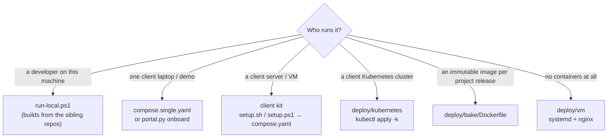
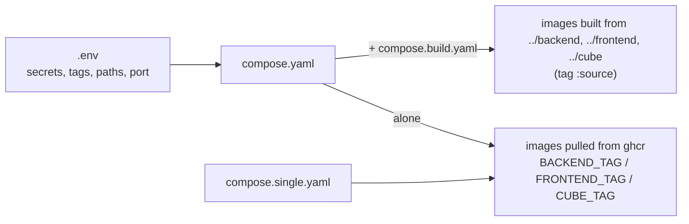
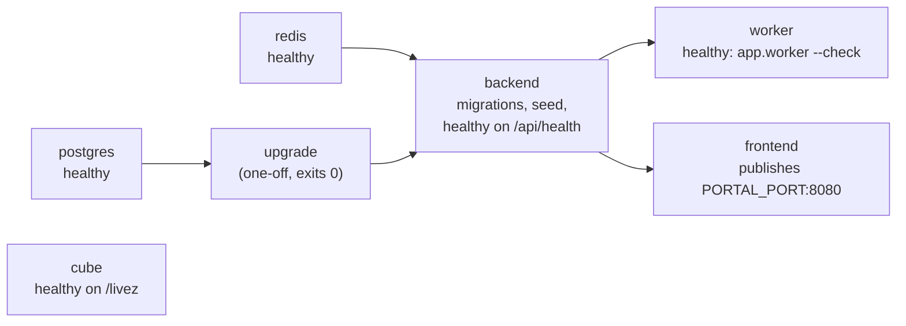
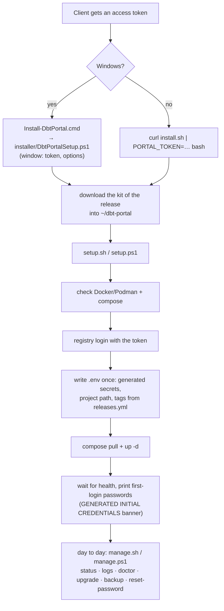
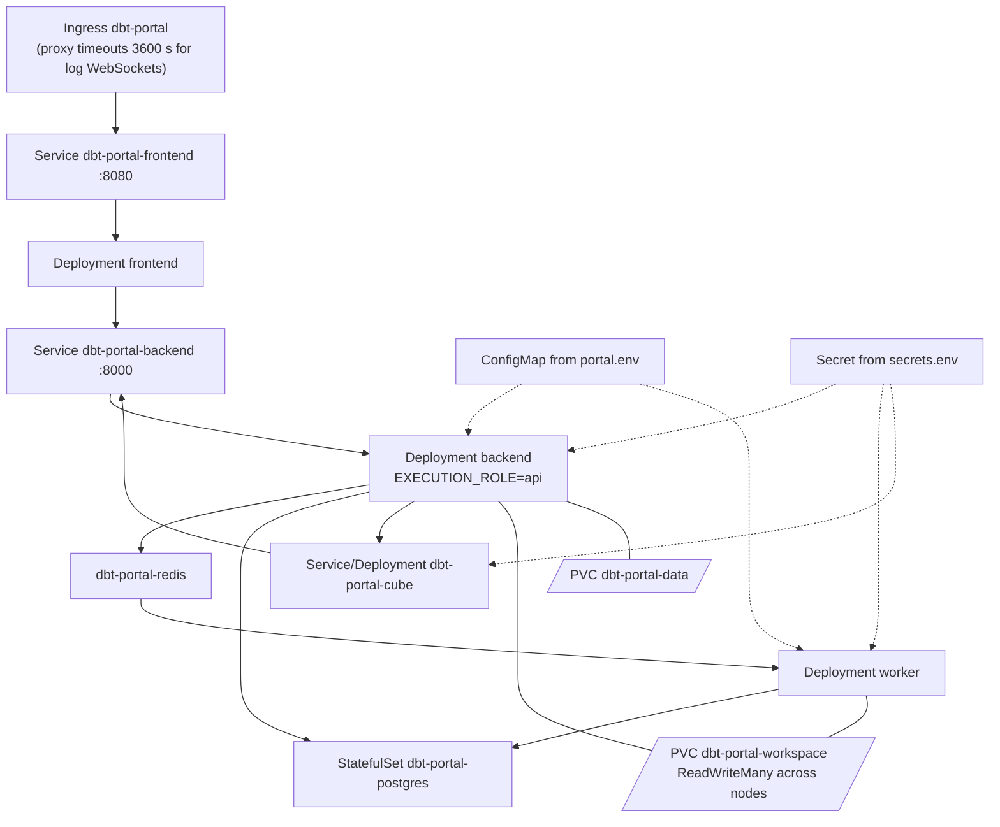
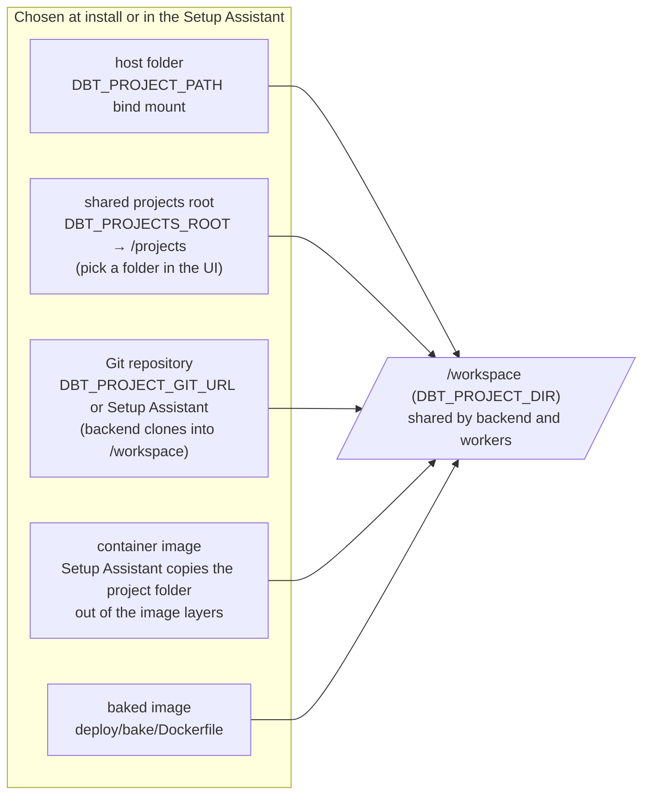
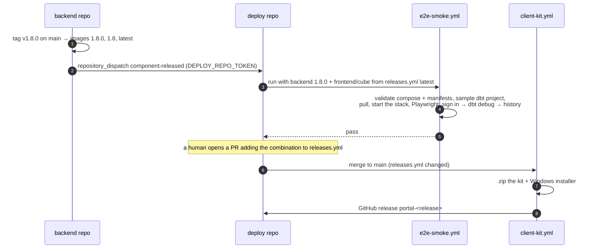

# Deploy repo developer guide

This repo holds no application code. It decides **how the images run
together** (compose, Kubernetes, VM, client kit) and **which versions go
together** (`releases.yml`). Read [SYSTEM_GUIDE.md](SYSTEM_GUIDE.md) first for
the whole picture and [ARCHITECTURE.md](ARCHITECTURE.md) for the containers.
Operators installing for a client read [ONBOARDING.md](ONBOARDING.md).

- [1. Folder map](#1-folder-map)
- [2. Deployment shapes](#2-deployment-shapes)
- [3. How the compose files combine](#3-how-the-compose-files-combine)
- [4. The client kit](#4-the-client-kit)
- [5. Kubernetes](#5-kubernetes)
- [6. How the dbt project reaches the containers](#6-how-the-dbt-project-reaches-the-containers)
- [7. Releases and CI](#7-releases-and-ci)
- [8. Recipes](#8-recipes)

---

## 1. Folder map

```
compose.yaml            full stack: frontend, backend (api), worker, cube, postgres, redis, upgrade
compose.single.yaml     one node: backend runs dbt itself on SQLite, + cube + frontend
compose.build.yaml      overlay: build images from ../backend, ../frontend, ../cube
run-local.ps1           developer shortcut: compose.yaml + compose.build.yaml on :8090
releases.yml            portal releases: backend + frontend + cube versions tested together
postgres/upgrade.sh     one-off migration from the pre-2026.11 multi-database layout
deploy/
  client/               the client kit: setup/manage/install (.sh and .ps1), lib, .env.example,
                        portal.answers.example, Windows installer (installer/, download/)
  kubernetes/           kustomize: namespace, data stores, workspace PVC, backend, worker, cube,
                        frontend, ingress, portal.env, secrets.env.example
  bake/Dockerfile       backend image with the client's dbt project baked in
  vm/                   systemd unit + nginx config for a bare VM
e2e/                    Playwright smoke test of a whole stack
docs/                   ARCHITECTURE, ONBOARDING, SYSTEM_GUIDE, this guide, diagrams (.drawio/.png)
.github/workflows/      pre-check, e2e-smoke, client-kit
```

## 2. Deployment shapes



| Shape | Containers | Database | Queue | Scales |
|---|---|---|---|---|
| single node | backend (runs dbt), cube, frontend | SQLite on `portal_data` | none | no |
| full stack (compose / client kit) | frontend, backend, worker ×N, cube, postgres, redis | PostgreSQL | Redis | workers (`--workers`, `WORKER_CONCURRENCY`) |
| Kubernetes | same as full stack, as Deployments | PostgreSQL (in-cluster or managed) | Redis (same) | workers, cube, frontend replicas |

## 3. How the compose files combine



Startup order in `compose.yaml`:



Things that look odd but are deliberate:

- `user: ${PORTAL_USER:-10001:10001}`: non-root. Windows/macOS bind mounts
  need `PORTAL_USER=0:0` because they refuse `chmod` from other users and
  `dbt deps` fails.
- The backend's healthcheck is declared in compose, not only in the
  Dockerfile: Podman builds OCI images, which drop `HEALTHCHECK`.
- Redis runs with a password, no persistence: job requests briefly carry a
  one-off provisioning login, and nothing in Redis must survive a restart.
- The worker gets `DBT_PROJECT_GIT_URL: ""`: only the backend clones the
  project in git mode; the worker just mounts it.

## 4. The client kit

What a client receives: a zip per release (built by `client-kit.yml`) and a
Windows installer. No source, no build.



- `.env` is written **once**; re-running setup keeps it, so accounts and
  history survive upgrades.
- `portal.answers` (see `portal.answers.example`) makes setup zero-touch:
  `PROJECT`, `PORT`, `RELEASE`, `WORKERS`, and any other key goes into `.env`.
- `lib.sh` / `lib.ps1` hold what both scripts share. Shell scripts must pass
  `shellcheck` (CI runs it) and work on macOS, Linux and WSL; PowerShell
  scripts must work in Windows PowerShell and Podman.

## 5. Kubernetes



- `kustomization.yaml` sets the namespace (`dbt-portal`), generates the
  ConfigMap and Secret, and pins the image tags (keep them on one
  `releases.yml` entry).
- In production, delete `data-stores.yaml` from `resources` and point
  `DATABASE_URL` / `REDIS_URL` at managed services.
- First-login passwords: `kubectl -n dbt-portal logs deploy/dbt-portal-backend`.

## 6. How the dbt project reaches the containers



## 7. Releases and CI



| Workflow | Runs on | Does |
|---|---|---|
| `pre-check.yml` | PRs into `dev`/`test`/`main` | promotion path (working branch → dev → test → main), gitleaks, shellcheck |
| `e2e-smoke.yml` | component releases, PRs, on demand | starts a real stack from published images and runs `e2e/smoke.spec.ts` |
| `client-kit.yml` | `releases.yml` changed on `main`, on demand | builds and attaches the client kit |

Secrets: `DEPLOY_REPO_TOKEN` (component repos → this repo),
`GHCR_READ_TOKEN` (pull private images in e2e), `TEAMS_WEBHOOK_URL`
(optional notifications).

## 8. Recipes

**Add a portal release.** After the component tags are published and the
e2e run for them passed: add an entry at the top of `releases.yml`
(`backend`, `frontend`, `cube`, `notes`), set `latest` to it, open a PR
through `dev → test → main`. Merging to `main` builds the client kit.

**Add an environment variable.** It is read by the backend
(`app/core/config.py`). Add it to `deploy/client/.env.example` (with a
comment), `deploy/kubernetes/portal.env` or `secrets.env.example`, and the
reference table in `ONBOARDING.md` §6. Only add it to `compose.yaml`'s
`environment:` when the value is computed there (like `DATABASE_URL`);
otherwise `.env` reaches the containers through `env_file`.

**Add a container.** Add it to `compose.yaml` (healthcheck, `restart`,
internal network only), to `compose.build.yaml` if it is built from a sibling
repo, to `deploy/kubernetes/` + `kustomization.yaml`, to the kit's file list
in `client-kit.yml`, and to `manage.sh services`. Update ARCHITECTURE.md and
the diagrams.

**Try a change to the stack locally.**

```powershell
.\run-local.ps1                 # builds from ../backend, ../frontend, ../cube, http://localhost:8090
.\run-local.ps1 -Down           # stop (add -Wipe to delete volumes)
```

```bash
docker compose -f compose.yaml config -q      # compose file parses (needs a .env)
shellcheck -x -S warning deploy/client/setup.sh deploy/client/manage.sh deploy/client/install.sh deploy/client/lib.sh   # what CI runs
cd e2e && npm ci && PORTAL_URL=http://localhost:8090 npm test   # the smoke test against your stack
```
