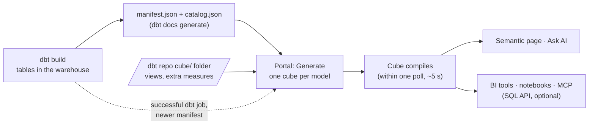
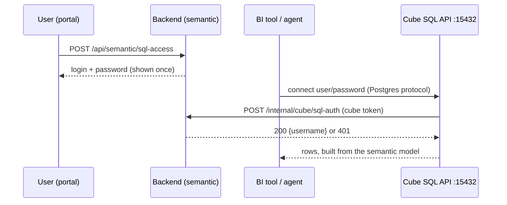

# Semantic layer: dbt + Cube, and using it from BI and AI tools

The portal runs [Cube](https://cube.dev) (open-source Cube Core) as a managed
semantic layer on top of the client's dbt project. This page explains how dbt
and Cube work together, what the portal generates, and how tools outside the
portal (BI, notebooks, AI agents) use the same metrics. The Semantic Modeling
page has the same guidance in its **How it works** and **Connect BI & AI** tabs.

## Why both

| | dbt | Cube |
|---|---|---|
| Job | Build tested, documented tables (marts) in the warehouse | Define business measures, dimensions and joins once, and serve them |
| Output | Tables and views, `manifest.json`, `catalog.json` | REST, GraphQL and a Postgres-compatible SQL API, caching, pre-aggregations |
| Who changes it | Analytics engineers, in pull requests | Generated from dbt; business logic added in the dbt repo's `cube/` folder |

dbt answers "is this data right?"; Cube answers "what does *revenue* mean, and
does every tool get the same number?". The portal connects them so nothing is
typed twice.

## Lifecycle



1. **dbt builds the marts** (dbt Runner, a schedule or CI).
2. **dbt describes them**: `target/manifest.json` (models, tests, descriptions)
   and `target/catalog.json` (column types, from `dbt docs generate`).
3. **The portal generates the Cube model** from the dbt folders picked on the
   Semantic Modeling page (marts are pre-selected). Generated files go to the
   backend's state directory (`<PORTAL_DATA_DIR>/cube/model/generated/`), the
   dbt repo's `cube/` folder is copied next to them (`custom/`).
4. **Cube compiles it.** `cube.js` polls the backend's `/internal/cube/state`;
   a new model version is live within one poll, no restart.
5. **Everything reads the same definitions**: the page's explorer and query
   builder, Ask AI, and, if published, BI and AI tools over the SQL API.

After the first Generate, a successful dbt job that writes a newer
`manifest.json` regenerates the model with the same folders
(`CUBE_AUTO_REGENERATE=true`, the default).

## What is generated from dbt

| In dbt | In Cube |
|---|---|
| Model (table, view, incremental) in a selected folder | Cube with `sql_table` = the manifest's `relation_name`. Ephemeral, disabled and installed-package models are skipped |
| Column + type (`catalog.json`, else `data_type` in YAML) | Dimension: `string`, `number`, `time` or `boolean`. JSON/array/struct columns are left for hand-written dimensions |
| Model and column descriptions | Cube and member descriptions (shown to BI tools and AI agents) |
| `unique` test or `primary_key` constraint (else an `id` / `<model>_id` column) | `primary_key: true` (correct counts across joins) |
| `relationships` test | `many_to_one` join to the referenced model |
| Numeric columns (optional) | `sum_<col>` for quantities, `average_<col>` for rates/prices/scores, `lowest_`/`highest_` for `min_`/`max_` columns, plus `count` per cube |
| `updated_at`, `_loaded_at` and similar | `refresh_key`: `SELECT MAX(col)` every minute, so caches drop when dbt changes the data |

Example. What the team already writes:

```yaml
# models/marts/_marts.yml
models:
  - name: fct_orders
    description: One row per order.
    columns:
      - name: order_id
        tests: [unique, not_null]          # -> primary key
      - name: customer_id
        tests:
          - relationships: { to: ref('dim_customers'), field: customer_id }   # -> join
      - name: amount
        description: Order value in EUR.
      - name: updated_at                   # -> refresh key
```

What the portal generates (never edit it; regeneration overwrites it):

```yaml
cubes:
  - name: fct_orders
    sql_table: ANALYTICS.MARTS.FCT_ORDERS
    description: One row per order.
    refresh_key: { sql: SELECT MAX(updated_at) FROM ANALYTICS.MARTS.FCT_ORDERS, every: 1 minute }
    joins:
      - { name: dim_customers, relationship: many_to_one, sql: "{CUBE}.customer_id = {dim_customers}.customer_id" }
    dimensions:
      - { name: order_id, type: number, primary_key: true, public: true }
      - { name: customer_id, type: number }
      - { name: amount, type: number, description: Order value in EUR. }
      - { name: updated_at, type: time }
    measures:
      - { name: count, type: count }
      - { name: sum_amount, type: sum, sql: "{CUBE}.amount", title: Total amount }
```

## Business logic: the dbt repo's `cube/` folder

Hand-written YAML (or JS) in `<dbt project>/cube/` is versioned and reviewed
with the dbt code and survives every regeneration:

- **Views**: the curated interface. One view per business question, joins
  worked out once, members grouped in folders. BI users and AI agents should
  query views, not cubes.
- **Extra measures**: `extends: fct_orders` in a new cube, then add measures
  such as `average_order_value` or filtered counts.
- **Pre-aggregations**: rollups for questions asked every day
  (`external: false` builds them in the warehouse; no Cube Store needed).
- **Hide raw cubes** with `public: false` once views cover them.

## Using the semantic layer outside the portal

| Consumer | Way in | Status |
|---|---|---|
| Business users in the portal | Semantic Modeling page (explore, query, CSV) | Built in |
| Plain-language questions | Ask AI (Data tab) answers through the semantic layer | Built in |
| Power BI, Tableau, Excel, Superset, Metabase | Cube **SQL API** (Postgres protocol) | Built in, below |
| Python, notebooks, JDBC/ODBC apps | SQL API with any Postgres driver | Built in, below |
| AI assistants and agents (Claude, Copilot, Cursor, custom) | A Postgres MCP server on the SQL API | Built in, below |

Cube's REST API stays internal: its tokens are signed with `CUBE_API_SECRET`,
the portal's own key to Cube. Never give that secret to a tool.

### Getting a login (each user, one click)

Nobody shares a password and no administrator hands one out. On the Semantic
Modeling page, **Connect BI & AI → Create my SQL password**:

- The login is the user's portal username; the password is a random token shown
  once, with a ready connection string, Python snippet and MCP config.
- Only a SHA-256 of it is stored (backend `CUBE_STATE_DIR/sql_logins.json`).
- Cube's `checkSqlAuth` (cube repo `cube.js`) asks the backend
  (`POST /internal/cube/sql-auth`) on every new connection, so the login works
  only while the user is active and has `observability.view`. A new password
  replaces the old one at once; **Delete** revokes it. Both are in the audit trail.

How the pieces fit:



### What the platform team does

Nothing, in the standard install: the cube image listens on 15432
(`CUBEJS_PG_SQL_PORT`) and `compose.yaml` publishes it as `CUBE_SQL_PORT`
(default 15432). Optional settings in `.env`:

```bash
CUBE_SQL_PORT=15432          # the host port BI tools use
CUBE_SQL_HOST=bi.example.com # when BI tools reach the host under another name
```

Kubernetes: the cube Service has a `sql` port (15432) inside the cluster. For
tools outside the cluster, expose it with an internal load balancer and set
`CUBE_SQL_HOST` / `CUBE_SQL_PORT` on the backend to that address.

Security notes:

- The SQL API is read-only: it answers queries over the model and never writes.
- A login sees every **public** cube and view. Publish views and hide raw cubes.
- Keep the port on the internal network or VPN, like the portal itself, or
  behind a TLS-terminating proxy. Passwords are 32-byte random tokens.

### BI tools

Connect as to a PostgreSQL database with the details on the Connect BI & AI tab:
host = the portal host, port 15432, database `cube` (any name works), your
portal username and the SQL password you created.

| Tool | Connector and mode |
|---|---|
| Power BI | PostgreSQL database, **DirectQuery** (numbers stay governed; don't re-aggregate measures in DAX) |
| Tableau | PostgreSQL, **Live** connection |
| Excel | PostgreSQL ODBC driver (psqlODBC) DSN, then Get Data → From ODBC |
| Superset / Metabase | PostgreSQL database, `postgresql://<username>:<password>@host:15432/cube` |

Queries use `MEASURE()` for measures and group by dimensions; Cube writes the
joins and aggregation:

```sql
SELECT DATE_TRUNC('month', order_date) AS month, status, MEASURE(sum_amount) AS revenue
FROM sales                -- a view
GROUP BY 1, 2
ORDER BY revenue DESC;
```

### Notebooks and apps

```python
import os, pandas as pd, psycopg
with psycopg.connect(host="portal-host", port=15432, dbname="cube",
                     user="<username>", password=os.environ["PORTAL_SQL_PASSWORD"]) as conn:
    df = pd.read_sql("SELECT status, MEASURE(count) AS orders FROM sales GROUP BY 1", conn)
```

### AI assistants and agents (MCP)

| Option | Fit for the portal |
|---|---|
| **Ask AI** in the portal | Ready now; uses the semantic layer with the portal's sign-in and permissions |
| **Postgres MCP server on the SQL API** | **Recommended** for external assistants: one MCP server with your own SQL login, agents see views and measures instead of raw tables |
| Cube's official MCP server | Cube Cloud only (hosted endpoint with OAuth, Premium/Enterprise plans). Not available for the self-hosted Cube Core the portal runs |
| Community Cube MCP servers on the REST API | Not recommended: they need `CUBE_API_SECRET` |

Example MCP client configuration (Claude Desktop, VS Code, Cursor) with the
open-source `postgres-mcp` server:

```json
{
  "mcpServers": {
    "semantic-layer": {
      "command": "uvx",
      "args": ["postgres-mcp", "--access-mode=restricted"],
      "env": { "DATABASE_URI": "postgresql://<username>:<password>@portal-host:15432/cube" }
    }
  }
}
```

Cube emulates the parts of Postgres's catalog that BI tools use, not all of
it: MCP tools that list tables and run `SELECT` work, tools that read Postgres
internals (index advice, `pg_stat_statements`) do not. The SQL API cannot
write, so if a server's read-only mode wraps queries in a transaction Cube
rejects, its unrestricted mode is still safe. Test the chosen server against
the client's model before rolling it out.

Give the agent short instructions so it uses the layer well:

```text
You answer data questions through a Cube semantic layer reached as a Postgres database.
- Each table is a cube or a view; prefer views. List them before guessing names.
- Select measures as MEASURE(<name>) and GROUP BY every other column.
  Never SUM/AVG a measure yourself and never join tables: views already hold the joins.
- Read column descriptions to choose fields, and say which view and measures you used.
```

Agents choose fields from their descriptions, so the AI readiness of the layer
is mostly the dbt documentation of the marts. The Overview tab on the Semantic
Modeling page shows the share of described fields and other model checks.

## Operations

- Supported warehouses for the semantic layer: Snowflake, PostgreSQL, Redshift
  and BigQuery (Databricks needs Cube's JDBC driver and comes later).
- Cube is stateless: login and model come from the backend (`/internal/cube`,
  contract version in `cube_manager.CONTRACT_VERSION` and `cube.js`).
- Logs: `docker compose logs cube`. Settings: `CUBE_API_SECRET`,
  `CUBE_API_URL`, `CUBE_AUTO_REGENERATE`, `PORTAL_SEMANTIC_URL` (see
  [ONBOARDING.md](ONBOARDING.md)).
- Code: backend `app/services/cube_model.py` (generation),
  `app/services/cube_manager.py` (state, versions), cube repo `cube.js`.
