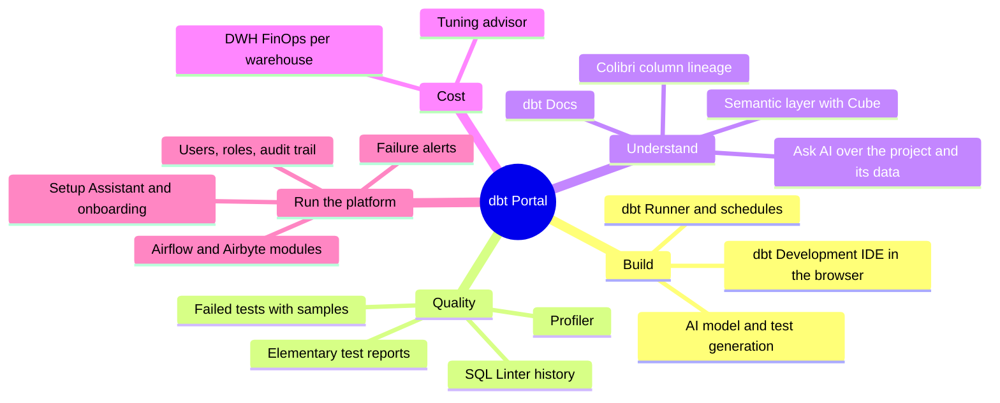
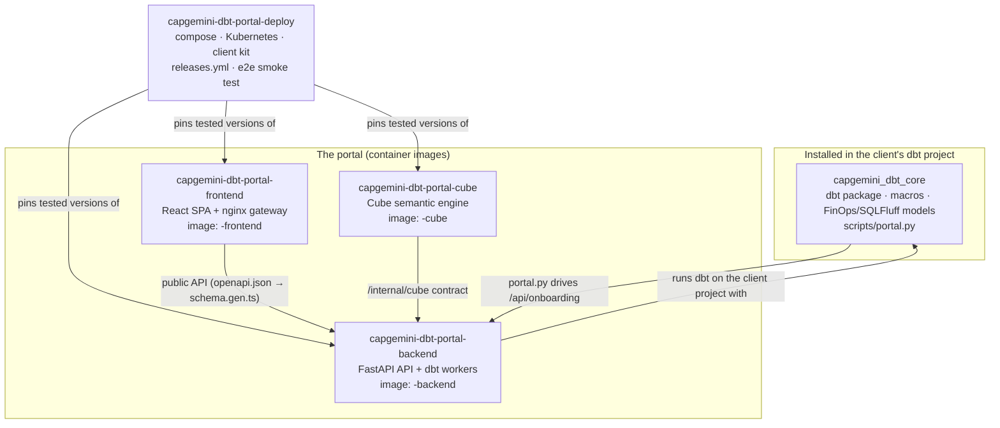
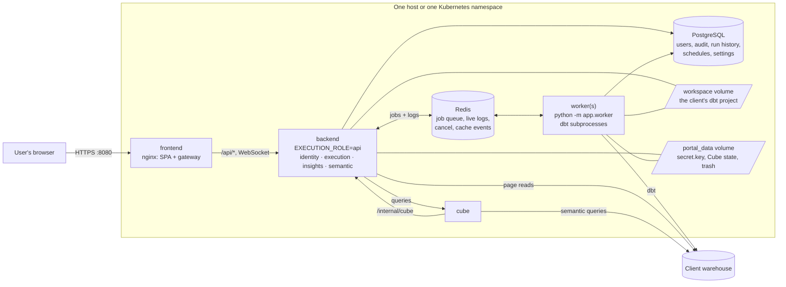
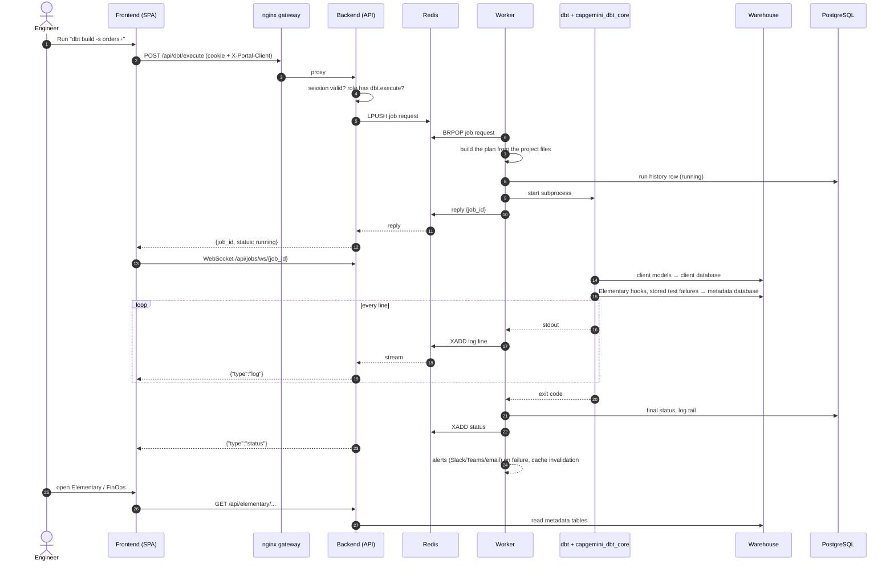
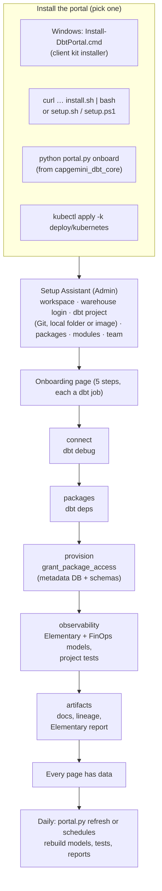
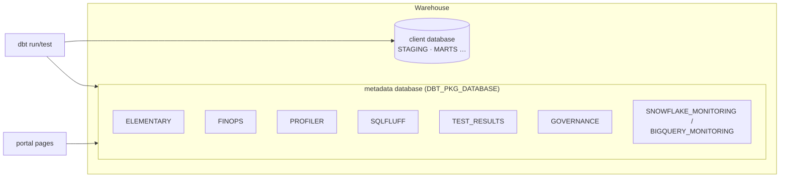
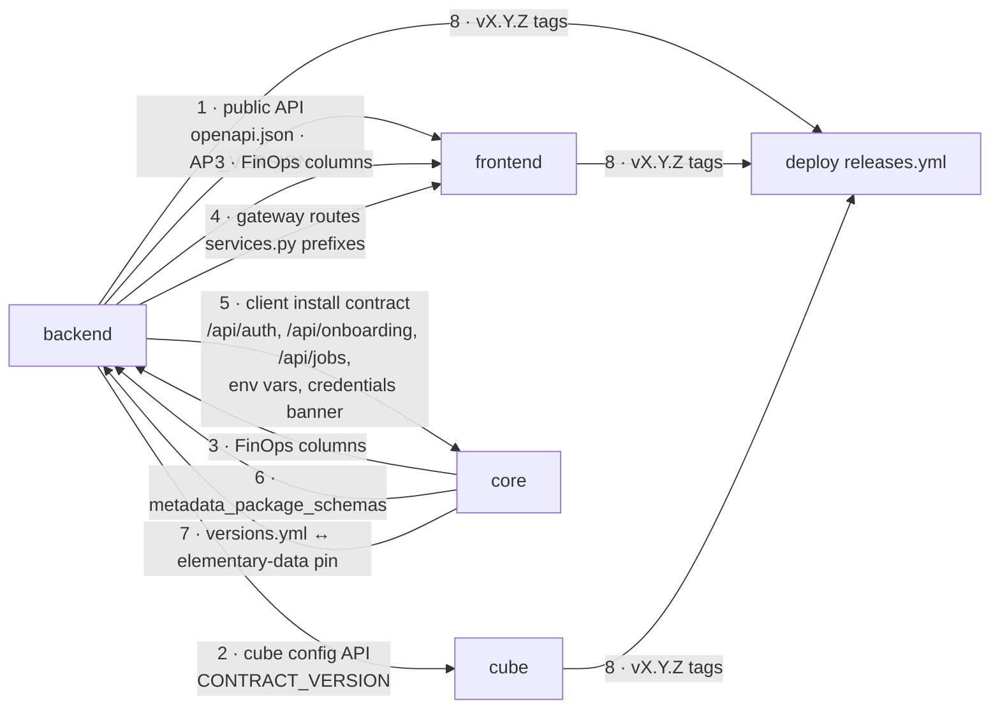
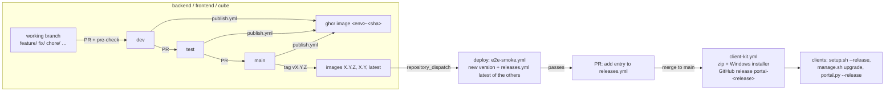
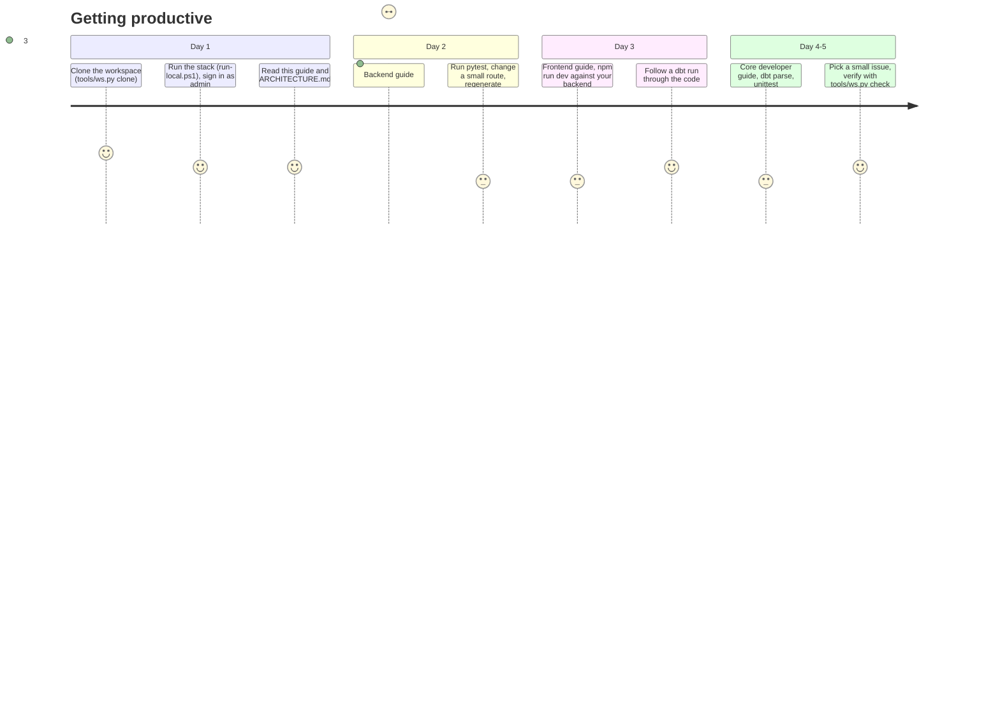

# System guide: the Data Engineering Accelerator end to end

Read this first if you are new to the team. It explains what the whole
system does, which repo holds which part, how a request and a dbt run travel
through it, and where to go next for each part.

- [1. What the system does](#1-what-the-system-does)
- [2. The five repos](#2-the-five-repos)
- [3. The running system](#3-the-running-system)
- [4. A dbt run, end to end](#4-a-dbt-run-end-to-end)
- [5. Onboarding a client project](#5-onboarding-a-client-project)
- [6. Where the data lives](#6-where-the-data-lives)
- [7. The contracts between repos](#7-the-contracts-between-repos)
- [8. From commit to client](#8-from-commit-to-client)
- [9. Your first week](#9-your-first-week)

---

## 1. What the system does

A client has a **dbt project** on a **warehouse** (Snowflake, Databricks or
BigQuery). The accelerator gives them, without installing Python or dbt:



Two halves make that work:

- a **dbt package** (`capgemini_dbt_core`) the client installs with
  `dbt deps`: it routes framework tables to a metadata database, provisions
  it, and builds the FinOps and SQLFluff models;
- the **portal** (backend, frontend, cube, deploy): a web app that runs dbt
  on the client's project and turns what dbt produces into pages.

## 2. The five repos



| Repo | Read next |
|---|---|
| `capgemini_dbt_core` | [docs/DEVELOPER_GUIDE.md](https://github.com/omaryehia015/capgemini_dbt_core/blob/main/docs/DEVELOPER_GUIDE.md), then `docs/technical/` |
| `capgemini-dbt-portal-backend` | [docs/README.md](https://github.com/omaryehia015/capgemini-dbt-portal-backend/blob/main/docs/README.md) |
| `capgemini-dbt-portal-frontend` | [docs/README.md](https://github.com/omaryehia015/capgemini-dbt-portal-frontend/blob/main/docs/README.md) |
| `capgemini-dbt-portal-cube` | [docs/GUIDE.md](https://github.com/omaryehia015/capgemini-dbt-portal-cube/blob/main/docs/GUIDE.md) |
| `capgemini-dbt-portal-deploy` (this repo) | [ARCHITECTURE.md](ARCHITECTURE.md), [DEVELOPER_GUIDE.md](DEVELOPER_GUIDE.md), [ONBOARDING.md](ONBOARDING.md) |

The repos only work together when checked out **side by side** in one
folder (`../<repo>` paths in `compose.build.yaml`, `run-local.ps1` and the
frontend's `npm run gen:api`). The team workspace's `tools/ws.py clone` does
that.

## 3. The running system



Only the frontend port is published. The single-node variant
(`compose.single.yaml`) drops Redis, PostgreSQL and the worker: the backend
runs dbt itself on SQLite. Details per container:
[ARCHITECTURE.md](ARCHITECTURE.md).

## 4. A dbt run, end to end

What happens when an engineer clicks **Run** on the dbt Runner page:



## 5. Onboarding a client project



Every step is judged from real state (files, warehouse), not from clicks,
so re-running anything is safe. Full operator guide:
[ONBOARDING.md](ONBOARDING.md).

## 6. Where the data lives

| Data | Where | Owner |
|---|---|---|
| Client models | client database / schemas in the warehouse | the client's dbt project |
| Elementary, FinOps, profiler, SQLFluff history, stored test failures | **metadata database** (`DBT_PKG_DATABASE`), one schema per package | `capgemini_dbt_core` routing |
| Users, roles, sessions, audit trail | PostgreSQL (`portal_users`, ...) | backend identity service |
| Run history, schedules, settings (warehouse login encrypted) | PostgreSQL (`portal_job_history`, `portal_schedules`, `portal_settings`) | backend execution service |
| dbt artifacts (`manifest.json`, `run_results.json`, reports) | `target/` in the workspace volume | dbt, read by insights |
| Cube login and generated model | `/data/cube` | backend semantic service |
| Encryption key for stored secrets | `/data/secret.key` or `PORTAL_SECRET_KEY` | backend |
| Live logs, job queue | Redis (nothing survives a restart, nothing needs to) | backend + workers |



## 7. The contracts between repos

These break **silently** when only one side changes. Change both sides in
the same piece of work (the `cross-repo-contracts` skill has the checklist).



| # | Contract | Producer | Consumer | Guarded by |
|---|---|---|---|---|
| 1 | Public API | backend `openapi.json`, `API_VERSION` | frontend `schema.gen.ts`, `version.ts` | backend CI (stale schema), frontend `tsc`, version banner |
| 2 | Cube config API | backend `CONTRACT_VERSION` | cube `CONTRACT` | cube log error at start, `releases.yml` |
| 3 | FinOps columns | core `models/finops/` | backend FinOps service, frontend FinOps page | `pytest/test_finops_models.py` (core), `tests/test_finops_contract.py` (backend) |
| 4 | Gateway routes | backend `app/core/services.py` | frontend `nginx/default.conf.template` | review |
| 5 | Client install | backend auth/onboarding/jobs, env vars, log banner | core `scripts/portal.py` | `pytest/test_portal_script.py` |
| 6 | Package schemas | core `metadata_package_schemas` | backend onboarding | shared var, read at run time |
| 7 | Versions | core `versions.yml` | backend `requirements.txt` | review |
| 8 | Releases | each repo's tags | deploy `releases.yml` | e2e smoke test |

When a change spans repos, merge **producer first**: core → backend → cube
→ frontend → deploy.

## 8. From commit to client



The core package promotes `dev → uat → main` and is consumed by clients
through `packages.yml` (git revision), not through images.

Nothing is committed or pushed without being asked, and pushes to
`dev`/`test`/`main` publish images: see the workspace `CLAUDE.md` for the
branch rules.

## 9. Your first week



Commands you will use every day (from the workspace folder):

```bash
python tools/ws.py status                 # branch and dirty files of every repo
python tools/ws.py check backend frontend # each repo's CI checks, locally
cd capgemini-dbt-portal-deploy && ./run-local.ps1   # whole stack at http://localhost:8090
```
